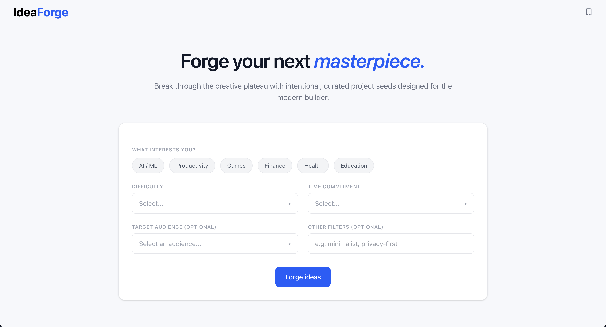

# IdeaForge

A lightweight AI-powered project idea generator built with Next.js, React, Tailwind CSS, and the OpenAI API.



## Overview

IdeaForge helps builders discover new project concepts by generating a single, creative, buildable idea based on selected interests, difficulty, time commitment, and audience.

## Features

- Select interest categories using interactive tags
- Choose difficulty, time commitment, and target audience
- Generate an AI-powered project idea via a Next.js API route
- Display idea output with title, description, feature highlights, and recommended tech stack
- Loading skeleton while the AI response is pending
- Actions on result cards for regenerating and copying idea content

## Tech Stack

- Next.js
- TypeScript
- Tailwind CSS
- OpenAI Node SDK
- lucide-react icons

## Project Structure

- `src/app/page.tsx` - main landing page that renders the navbar, hero, and idea form
- `src/app/api/generate-idea/route.ts` - serverless route that calls OpenAI and returns structured JSON
- `src/lib/openai.ts` - OpenAI client configuration using `OPENAI_API_KEY`
- `src/components/sections/IdeaForm.tsx` - idea generation form and fetch logic
- `src/components/sections/Hero.tsx` - landing page hero section
- `src/components/layout/Navbar.tsx` - top navigation bar
- `src/components/ui/` - reusable UI components for dropdowns, tags, cards, skeletons, and inputs

## Getting Started

1. Install dependencies:

```bash
npm install
```

2. Create a `.env` file with your OpenAI API key:

```bash
OPENAI_API_KEY=your_openai_api_key_here
```

3. Start the development server:

```bash
npm run dev
```

4. Open the app in your browser:

```bash
http://localhost:3000
```

## Environment Variables

- `OPENAI_API_KEY` - required for the API route to communicate with OpenAI

## Notes

- The API uses the `gpt-4o-mini` model and requests responses as a JSON object.
- The UI includes an optional filters input, but the current `Input` component is not yet wired to state, so additional filters are not sent to the backend.

---

