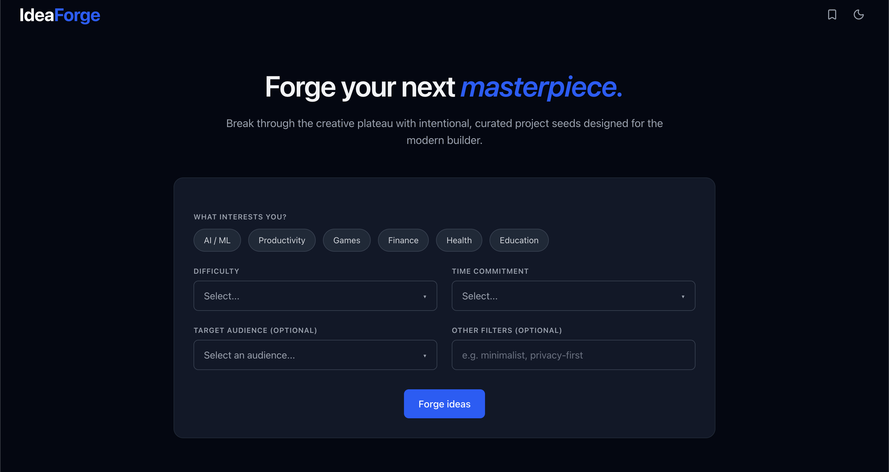

# IdeaForge

IdeaForge is a polished AI-powered project idea generator for creators who want a fast spark of inspiration. It turns a few inputs like interests, difficulty, time horizon, and audience into a single, practical product concept with features and a recommended tech stack.

<div style="display: flex; gap: 8px;">




</div>

## Overview

The app is built as a lightweight Next.js experience with a single-page idea builder. Users select their interests, define the scope of the build, and ask the app to generate a project idea. The backend calls OpenAI and returns structured JSON that is rendered as a polished idea card.

## What it does

- Lets users choose multiple interests such as AI/ML, productivity, games, finance, health, and education
- Captures difficulty, time commitment, and target audience for more tailored ideas
- Generates one creative, buildable product concept through the `/api/generate-idea` route
- Renders the result as a formatted idea card with:
  - title
  - description
  - key features
  - recommended tech stack
- Supports regeneration, copying text, and bookmarking ideas
- Includes a bookmark sidebar with search and saved idea management
- Ships with light and dark mode support

## Key features

- Interactive interest tags
- Structured generation form with dropdown selectors
- Loading state using skeleton UI during AI generation
- Sidebar for saved ideas with fuzzy search
- Local persistence of bookmarks using browser storage
- Responsive modern UI built with Tailwind CSS

## Tech stack

- Next.js 16
- React 19
- TypeScript
- Tailwind CSS
- OpenAI Node SDK
- lucide-react

## Project structure

```text
src/
  app/
    page.tsx                  # Home page
    api/generate-idea/
      route.ts                # OpenAI generation endpoint
  components/
    layout/
      Navbar.tsx             # Top navigation and bookmark toggle
      BookmarksPanel.tsx     # Saved ideas drawer
      ThemeToggle.tsx
    sections/
      Hero.tsx               # Landing copy
      IdeaForm.tsx           # Main idea-generation form and result UI
    ui/
      Dropdown.tsx
      IdeaCard.tsx           # Generated idea output card
      IdeaSkeleton.tsx       # Loading state
      Input.tsx
      Section.tsx
      TagGroup.tsx
  lib/
    bookmarks.ts              # Bookmark localStorage utilities
    openai.ts                 # OpenAI client setup
styles/globals.css
```

## Getting started

1. Install dependencies:

```bash
npm install
```

2. Add your OpenAI API key to a `.env` file:

```bash
OPENAI_API_KEY=your_openai_api_key_here
```

3. Start the local development server:

```bash
npm run dev
```

4. Open the app in your browser:

```bash
http://localhost:3000
```

## Environment variables

- `OPENAI_API_KEY` — required for the server route to call the OpenAI API.

## Notes and current limitations

- The AI request uses the `gpt-4o-mini` model and asks for a JSON object response.
- The optional "Other filters" input exists in the UI, but it is not currently wired to the request body, so it is not sent to the backend.
- Bookmarks are stored in the browser via localStorage instead of a database, which keeps the app lightweight and frontend-only.

## Development commands

```bash
npm run dev     # start the app locally
npm run build   # create a production build
npm run lint    # run ESLint checks
```

---

